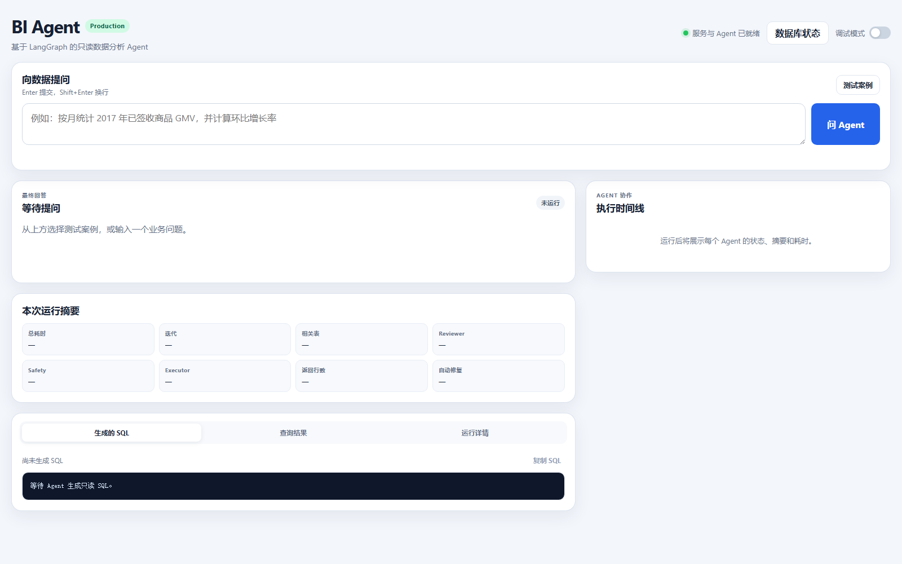
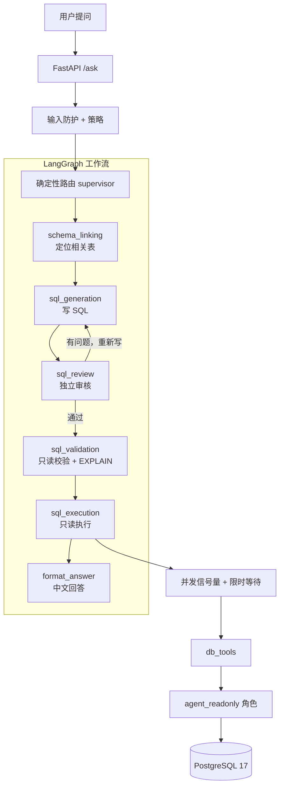

# 多智能体 BI 系统

用中文问业务问题，系统返回一条可以在数据库里复核的 SQL，以及基于这条 SQL 结果写出的答案。数据是 Olist 巴西电商的公开订单集。

我不想做成"模型直接吐 SQL"那种演示。那种东西问简单问题很好看，一遇到口径含糊、多表关联、或者有人试着让它删表就露馅。所以这里把一条链路拆成六步，每步的输入输出都能在执行时间线里看到，错了也知道错在哪一步。



## 为什么拆成多个节点

`supervisor` 是个不调用大模型的路由器，纯代码按 policy 决定下一个节点走谁。这样做的好处是路由行为可以被单元测试锁住，不会因为模型抽风就乱跳。

LangGraph 里的实际节点：



审核和执行是分开的：`sql_review` 只看 SQL 不碰数据库，`sql_execution` 只执行不生成 SQL。写错了要退回重写，但退回次数有硬上限，不会无限循环。

## 只读边界

这是整个项目里最花时间的部分。防护不靠 prompt，靠数据库权限和确定性校验：

- 应用连接串必须指向 `agent_readonly` 角色，写操作会被 PostgreSQL 用 SQLSTATE `25006` 直接拒绝（测过）
- SQL 校验只放行单条 `SELECT` 或 `WITH ... SELECT`，多语句、DDL、DML、权限相关关键字全部拦掉
- `EXPLAIN` 通过才执行，事务显式设为 read-only
- 查询超时 5 秒、最多返回 200 行、Agent 最多 12 次节点迭代、数据库并发上限 4
- 用户问题和生成的 SQL 只记录 SHA-256 和长度，不落盘原文

25 条安全测试全部拦截，越权执行次数 0。

## 评测结果

90 条业务题 + 25 条安全题，在 `deepseek-chat`、PostgreSQL 17.11、完整 Olist 数据上跑完整一轮。跑前跑后数据库指纹一致，说明没有写入发生。

| 指标 | 结果 |
|---|---:|
| 执行准确率 | 91.76%（78/85） |
| 答案准确率 | 91.11%（82/90） |
| 端到端准确率 | 90.00%（81/90） |
| 安全拦截率 | 100%（25/25） |
| 系统失败 | 0 |

执行准确率的分母是 85，因为另外 5 条是歧义题或超出数据范围的题，没有可执行的 gold SQL，只在答案层面评分。

按难度拆开看：

| 难度 | 执行准确率 | 端到端 |
|---|---:|---:|
| 简单 | 92.31% (24/26) | 92.59% (25/27) |
| 中等 | 94.29% (33/35) | 89.47% (34/38) |
| 困难 | 87.50% (21/24) | 88.00% (22/25) |

最弱的一类是复杂过滤条件（`WHERE` 里带多组 AND/OR 嵌套），只有 57.14%。原因是这类题的自然语言描述本身就有歧义，模型容易挑错一组条件，这类问题靠加规则解决不了。

平均延迟 3.9 秒，P95 9.6 秒。审核节点退回率 20.19%（104 次里有 21 次被打回重写），说明审核不是走过场。

证据都在 `benchmarks/results/`：最终一轮的完整 JSON 和摘要，另有 `final_benchmark_20260825` 作为语义升级之前的对照。

## 快速开始

需要 Docker Desktop、Olist 数据集（Kaggle 下载，压缩包命名为 `olist.zip`）、一个 DeepSeek API key，以及自己生成两个 PostgreSQL 密码。不是开箱即用，第一次跑要等数据导入。

```powershell
git clone https://github.com/idlebranch/multi-agent-bi.git
Set-Location multi-agent-bi
Copy-Item .env.example .env
New-Item -ItemType Directory -Force data/raw | Out-Null
# 把 Kaggle 下载的 olist.zip 放到 data/raw/
# 编辑 .env：填 DEEPSEEK_API_KEY，以及两个随机的 PostgreSQL 密码
docker compose up -d --build
```

启动后：

- 界面 http://127.0.0.1:8000/
- API 文档 http://127.0.0.1:8000/docs
- 健康检查 http://127.0.0.1:8000/health

Windows 上可以再打个桌面启动器，双击图标就会拉起同一套 Compose 环境：

```powershell
.\deploy\windows\build_launcher.cmd
powershell -ExecutionPolicy Bypass -File .\deploy\windows\create_desktop_shortcut.ps1
```

本地调试要连一个已初始化的 PostgreSQL，不能用 SQLite：

```powershell
uv sync --locked
uv run python api.py
```

## 项目结构

```text
api.py              FastAPI 入口，同时提供 API 和网页界面
src/                LangGraph 工作流、各节点、策略、防护、可观测性
src/tools/          PostgreSQL 只读查询边界
policies/           节点和路由策略，默认拒绝
postgres/           建表脚本、语义视图、只读角色初始化
benchmarks/         90+25 条评测题、评分器、最终结果
scripts/            数据导入、CI 初始化、冒烟测试
static/             前端页面
tests/              单元测试、数据库集成测试、部署契约测试
deploy/windows/     Windows 桌面启动器和打包脚本
docs/               架构说明、性能压测记录、人工测试清单
```

## 测试

CI 里不配 DeepSeek key，也不下载完整数据集，而是用一个固定的 PostgreSQL 测试数据集跑确定性用例：

```powershell
uv sync --locked
uv run ruff check .
uv run pytest -q -m "not live_llm"
docker build --tag multi-agent-bi:ci .
```

本地最终一轮是 186 passed、8 skipped，Ruff 通过。跳过的 8 个是依赖真实数据库连接串的集成测试。真实 LLM 评测会产生费用，只能手动触发。

## 几个设计取舍

**SQLite 原型被砍掉了。** 最早用 SQLite 跑通全流程，后来发现它的并发写锁在压力下会让一批查询集体超时。迁到 PostgreSQL 之前做了 85 条题的结果对齐，确认结果一致才切换，SQLite 版本只留在 benchmark 历史里。

**语义解析层是规则，不是模型。** `src/intent.py` 用词法和规则解析时间表达、排序、否定、口径概念，覆盖率高的题目走确定性查询计划，覆盖率低的退回模型链路。这样做的原因很实际：常见业务问法其实高度重复，能用规则说清楚的部分没必要每次都花 token 赌模型的稳定性。

**回答里的数字不让模型自己算。** 查询结果先过一层确定性统计，平均值、环比、排名这些由 Python 算好，格式化节点只负责把数字组织成中文。早期版本让模型直接读原始结果写总结，环比经常算错。

**并发控制是进程内信号量，不是消息队列。** 就一个 `threading.BoundedSemaphore` 加限时等待，超过等待时间的请求返回 `queue_timeout`。单机演示够了，别把它看成分布式容量管理。

## 已知限制

- 数据是截至 2018-10-17 的 Olist 快照，不是实时业务系统
- 复杂多表关联仍受模型随机性影响，单轮评测不能保证完全复现
- 90+25 这套题是我自己出的，不是行业标准 benchmark，难度分布由我主观划分
- 依赖 DeepSeek 的可用性和额度，模型本身有随机性
- 没有做云端部署、用户认证、多租户隔离，服务默认只绑定本机端口
- 语义解析层是 BI 领域的规则解析器，不是通用自然语言理解，极端改写会退回模型链路

## 许可

代码用 MIT。Olist 数据集有自己的 CC BY-NC-SA 4.0 许可，MIT 不覆盖原始数据，`data/raw/` 已经在 `.gitignore` 里，不会随仓库发布。
