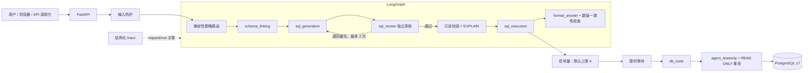
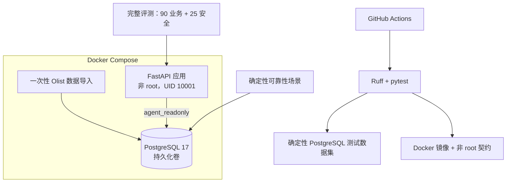

# 架构说明

## 请求路径

正式链路里的路由器是确定性的，不产生任何 planner/router 的 LLM 调用。schema_linking 可以在不调用模型的情况下完成表选择，也可以用一次目录查询；真正会调用模型的是 sql_generation、sql_review 和 format_answer 三个阶段。退回重写占用的是同一个固定预算内的额外 sql_generation 调用。

## 并发语义

数据库这一层用的是进程内 `threading.BoundedSemaphore` 加限时获取。这只是有上限的并发和有上限的等待，不是消息队列：没有 broker、没有持久化队列、没有 worker 消费者，也没有可配置的队列长度。等不到容量的调用会收到兼容性错误码 `queue_timeout`，错误信息里会直接说明是数据库容量等待超时。

## 部署与验证

导入真实数据需要外部 Olist 压缩包和 owner 凭据。运行时查询走的是另一个只读角色。CI 全程不需要 DeepSeek 凭据，也不需要完整数据集。

## 可观测性边界

每个工作流运行输出一条 JSON 记录，包含：

- `request_id`、`run_id`、UTC 时间和总延迟
- 节点名、尝试次数、状态和耗时
- 路由与审核决策、退回次数、数值一致性结果
- 校验与执行状态、返回行数、是否截断、容量等待时长、错误码
- 可用与选中的表数量、实际的上下文长度
- 实际的 LLM 阶段调用次数，以及 provider 上报的 token 用量（拿不到就标记为不可用）

记录里刻意不包含完整的用户问题、SQL 原文、数据库结果、凭据和 provider 异常信息。问题和 SQL 只存 SHA-256 和长度。
